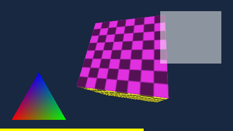

# 0001 · PSP-Grafik: Vulkan über MoltenVK

Status: Vorgeschlagen · 6. November 2026, am selben Tag nach einer Prüfung überarbeitet

Kennzeichnung: **belegt** heißt im Spike ausgeführt oder im Quelltext/SDK nachgelesen (in Klammern steht, womit), **Annahme** heißt nicht geprüft, **Gerät** heißt erst auf dem iPhone Duo prüfbar.

## Kontext

PSP ist das riskanteste System im Plan: PPSSPP rendert nicht in einen Pixelpuffer, sondern verlangt über `RETRO_ENVIRONMENT_SET_HW_RENDER` einen GPU-Kontext vom Host (Plan, Abschnitt 5, Leitplanke 5; Abschnitt 11, erstes Risiko). M0 Schritt 7 sollte klären, ob PPSSPP in unserem eigenen Host mit GPU-Grafik läuft und welcher Weg in M3 kommt, bevor Arbeit daran hängt.

Aufbau des Spikes (belegt):

- **Kern:** PPSSPP v1.20.4 (Commit `fa50bb1`) als Submodul `Cores/ppsspp`, libretro-Ziel über PPSSPPs CMake, gebaut mit `Scripts/build-core.sh ppsspp` für iPhone und Simulator (arm64, `minos 27.0`). Nötig sind 13 der 23 Unter-Submodule und ein verschachteltes in armips. FFmpeg ist abgeschaltet (siehe Folgen). OpenGLES ist nur schwach gelinkt (siehe „Der Kern und OpenGLES.framework“).
- **Host:** `Spikes/PSPGPU`, eine iOS-App, die den Kern per `dlopen` aus `Frameworks/` lädt, die Environment-Callbacks bedient und drei Wege anbietet: OpenGL ES über EAGL, Vulkan über MoltenVK 1.4.2 (offizielles Release von Khronos) und PPSSPPs Software-Renderer. Den Inhalt kopiert er vor dem Start in den Dokumentenordner, wie später importierte Spiele. Auf Wunsch durchläuft er den ganzen Lebenszyklus mehrmals, mit oder ohne `dlclose` dazwischen.
- **Inhalt:** eigenes Testprogramm `Tests/Fixtures/psp/gu-test.elf` (GPL-3.0, Quelltext im Repo, Lizenzen in `Tests/Fixtures/LICENSES.md`). Ein fertiges Homebrew mit eindeutiger Lizenz fand sich nicht; PPSSPPs Testsammlung `pspautotests` zum Beispiel hat keine Lizenz (`LICENSE.txt`: „TO FILL WITH THE LEAST RESTRICTIVE COMPATIBLE LICENSE“).
- **Lauf:** Simulator iPhone 18 Pro mit iOS 27.2 (24B8117), Xcode 27.2 (27B52), Mac mini M4 Pro. Während jedes Laufs ist das installierte App-Bundle schreibgeschützt, wie auf dem Gerät (`Spikes/PSPGPU/Scripts/run-spike.sh`). Der Duo-Simulator ließ sich nicht anlegen: Die Runtime iOS 27.2 (24B8117) schließt `iPhone19,4` (Duo) in ihrer `profile.plist` unter `unsupportedDeviceTypes` aus. Für die Grafikfrage spielt das Gerätemodell keine Rolle.

### Frage a: OpenGL ES im iOS-27.2-SDK und im Simulator

- **SDK (belegt, Header):** `OpenGLES.framework` liegt in `iPhoneOS27.2.sdk` und `iPhoneSimulator27.2.sdk` (Build 24B8118). `EAGLContext`, `EAGLSharegroup` und `EAGLGetVersion` tragen `OPENGLES_DEPRECATED(ios(2.0, 12.0), tvos(9.0, 12.0))`, dazu 246 Deklarationen in `ES3/gl.h` und 142 in `ES2/gl.h`. Der Makro-Text lautet „OpenGLES API deprecated. (Define GLES_SILENCE_DEPRECATION to silence these warnings)“. Die GL-Brücke von CoreVideo (`CVOpenGLESTextureCache`) ist mit „OpenGL/OpenGLES is no longer supported. Use Metal APIs instead.“ markiert. Als `unavailable` ist für iOS nichts markiert.
- **Simulator (belegt, Lauf):** Ein EAGL-Kontext mit `kEAGLRenderingAPIOpenGLES3` entsteht und läuft: `GL_VERSION OpenGL ES 3.0 APPLE-24.0.2`, `GL_RENDERER Apple Software Renderer`. OpenGL ES läuft im Simulator also auf der CPU.
- **Simulator (belegt, Lauf):** Der Zero-Copy-Weg zu Metal, ein IOSurface-`CVPixelBuffer` als GL-Textur und als `MTLTexture`, scheitert im Simulator an `CVOpenGLESTextureCacheCreateTextureFromImage` mit `-6683` (`kCVReturnPixelBufferNotOpenGLCompatible`). Der Spike liest dann mit `glReadPixels`. Ob der Weg auf dem Gerät geht: **Gerät**.
- **Zukunft (Annahme):** Eine Ankündigung, dass Apple OpenGL ES in iOS 27 entfernt, fand sich nicht (Websuche am 6. November 2026). Veraltet ist es seit iOS 12 (2018).

### Frage b: Was der Kern anfordert und was der Host bereitstellt

Belegt durch den Quelltext von PPSSPP v1.20.4 (`libretro/LibretroGraphicsContext.cpp`, `LibretroGLContext.h`, `LibretroVulkanContext.cpp`, `libretro_vulkan.cpp`) und die Berichte der Läufe in `docs/adr/0001/`.

Der Kern wählt in `retro_load_game`: Er fragt `GET_PREFERRED_HW_RENDER`, die Core-Option `ppsspp_backend` (`auto`, `opengl`, `vulkan`, `none`) überstimmt die Antwort. Dann versucht er GL, danach Vulkan, zuletzt den Software-Renderer. Der Spike setzt die Option und meldet denselben Typ als bevorzugt. Der GL-Versuch greift nur bei `DUMMY`, `OPENGL` oder `OPENGLES3`; ein Host, der `OPENGLES2` als bevorzugt meldet, bekäme kein GL.

| | OpenGL ES | Vulkan |
| --- | --- | --- |
| `SET_HW_RENDER` | `OPENGLES2`, Version 0.0, `depth` an, `stencil` aus, `bottom_left_origin` an, `cache_context` aus | `VULKAN`, Version 1.0.18 (steht im Feld `version_major`), `depth` an, `cache_context` an |
| Host stellt bereit | EAGL-Kontext (der Spike nimmt ES 3.0, der Kern erkennt „OpenGL ES 3.0 support detected“), Framebuffer mit Farbe und `DEPTH24_STENCIL8`, `get_current_framebuffer`, `get_proc_address` (`dlsym`). Der Kontext muss auf dem Thread aktuell sein, der `retro_run` aufruft. | `VkInstance`, `VkSurfaceKHR` auf einem `CAMetalLayer`, Device über die Negotiation, `retro_hw_render_interface_vulkan` Version 5 |
| Threads | CPU-Emulation auf einem eigenen Kern-Thread, die GL-Befehle laufen im `retro_run` des Hosts | ohne Befehlspuffer synchron in `retro_run`; mit Puffer zusätzlich ein Render-Thread (im Spike aus, siehe Folgen) |
| Bild | im Host-Framebuffer, Ursprung unten links, 480 × 270 bei 1x (PPSSPP schneidet standardmäßig auf 16:9 zu) | Der Kern ruft `set_image` aus seinem emulierten `vkQueuePresentKHR`, ohne Semaphoren, Layout `SHADER_READ_ONLY_OPTIMAL`, Format `B8G8R8A8_UNORM` |

Einzelheiten zum Vulkan-Weg (alle belegt):

- **Instanz:** Der Kern liefert `VkApplicationInfo` mit API 1.0, fragt aber `vkEnumerateInstanceVersion` ab und nutzt, was er findet. Der Host legt die Instanz deshalb mit der gemeldeten Version an (1.4.357), mit `VK_KHR_surface`, `VK_EXT_metal_surface`, `VK_KHR_get_physical_device_properties2` und `VK_EXT_swapchain_colorspace`.
- **Surface:** Pflicht. Der Kern setzt eine Surface voraus (`assert(surface)` in `vk_libretro_init`) und fragt über sie Fähigkeiten, Formate und Present-Modi ab, präsentiert aber nie.
- **Device:** Der Kern meldet Negotiation-Version 2, setzt aber nur `get_application_info` und `create_device` (Version 1); `create_instance`, `create_device2` und `destroy_device` sind leer. Er erzeugt das Device selbst und hängt die Pflichterweiterungen des Hosts an. `VK_KHR_portability_subset` aktiviert er nicht von sich aus, MoltenVK verlangt es laut Spezifikation, also übergibt der Host es, dazu `VK_EXT_metal_objects`.
- **Bilder:** Der Kern legt so viele „Swapchain“-Bilder an, wie `get_sync_index_mask` Bits hat, in der Größe 480 × 272 mal Skalierung (minus 2 Zeilen bei 16:9). Vor jedem Frame ruft er `wait_sync_index` und `get_sync_index`, seine Submits schließt er in `lock_queue`/`unlock_queue` ein. `set_command_buffers` und `set_signal_semaphore` nutzt er nicht.
- **Abbau:** `vkDestroyDevice` des Kerns ist ein leerer Wrapper, der Host räumt das Device nach `retro_unload_game` ab.
- **Bild nach Metal:** Der Host kopiert das Bild nach jedem Frame mit `vkCmdCopyImage` in ein eigenes `VkImage`, das mit `VkExportMetalObjectCreateInfoEXT` angelegt ist, und holt sich mit `vkExportMetalObjectsEXT` die `MTLTexture` (480 × 272, `BGRA8Unorm`, `MTLStorageModePrivate`). Ein Metal-Blit liest sie fehlerfrei. Die Spezifikation verlangt die Export-Absicht schon beim Erzeugen; das Bild des Kerns entsteht ohne sie, deshalb die Kopie. Sie kostet bei 1x 0,5 MB, bei 5x 13 MB pro Frame.

Für beide GPU-Wege gilt (belegt): `context_reset` nach `retro_load_game`, `context_destroy` vor `retro_unload_game`, weil der Kern seinen Kontext in `retro_unload_game` löscht und ein späteres `context_destroy` auf einen Nullzeiger fiele.

### Frage c: der Software-Renderer

Mit `ppsspp_backend=none` fordert der Kern keinen HW-Kontext an und liefert XRGB8888-Bilder über den normalen Video-Callback, 480 × 270, nur 1x (belegt, Lauf: `report-software-1x.txt`, mit `-scale 2` gleiches Bild, `report-software-2x.txt`). Für den Host ist das derselbe Pfad wie bei mGBA. Das Bild weicht in rund 9 % der Pixel vom GPU-Bild ab, die meisten davon um höchstens 8 Stufen (belegt). Ob er anspruchsvolle 3D-Spiele auf dem A20 Pro mit vollem Tempo schafft, ist offen (**Gerät**); PPSSPP beschreibt ihn selbst als „Slow, accurate“.

### Frage d (Teil): der Kern und OpenGLES.framework

PPSSPPs GL-Backend steckt in jedem gebauten Kern, auch wenn der Host Vulkan anbietet. Das ist für die Zukunftsfrage entscheidend:

- **Erstes Rezept (belegt, `otool -L`, `otool -l`):** Der Kern band `OpenGLES.framework` und `GLKit.framework` fest ein (`LC_LOAD_DYLIB`), auch auf dem Vulkan-Weg. GLKit nutzt er nicht (0 Importe); es kommt aus PPSSPPs `CMakeLists.txt`, das für `IOS AND LIBRETRO` `-framework GLKit` anhängt. Fiele OpenGLES weg, scheiterte schon das `dlopen`.
- **Jetzt (belegt, `kern-bindung.txt`):** Das Rezept linkt mit `-weak_framework OpenGLES` und `-dead_strip_dylibs`. Es bleiben `libz`, `libc++`, `libSystem` und OpenGLES als `LC_LOAD_WEAK_DYLIB`, alle 98 GL-Importe tragen `weak-import`. GLKit und `libobjc` (beide ohne Importe) fallen weg. Das Rezept bricht ab, wenn GLKit wieder auftaucht oder OpenGLES fest gebunden ist.
- **Kein GL-Aufruf auf dem Vulkan- und dem Software-Weg (belegt, Lauf: `gl-falle.txt`):** Eine Falle ersetzt per `DYLD_INSERT_LIBRARIES` alle 98 GL-Funktionen, die der Kern importiert, durch eine, die Namen und Aufrufer ausgibt und den Prozess beendet. Vulkan und Software laufen damit je 600 Frames, mit denselben Prüfsummen wie ohne Falle. Gegenprobe auf dem GL-Weg: Die Falle hält beim ersten GL-Aufruf des Kerns (`glGetIntegerv` aus `ppsspp_libretro`), sie erreicht den Kern also.
- **Folgerung (Annahme für ein künftiges iOS):** Fehlt `OpenGLES.framework` einmal, lädt dyld den Kern trotzdem und bindet die GL-Symbole an null (`ld(1)` zu `-weak_framework`: „marked as weak imports“). Der Vulkan-Weg liefe weiter, nur der GL-Weg wäre tot. Nachstellen lässt sich das im Simulator nicht, dort ist das Framework vorhanden.
- **Bleibt:** Der Kern enthält PPSSPPs GL-Backend weiter als Code. Liefert ein künftiges SDK keine GL-Header mehr, bricht der Build des Kerns. Dann muss das GL-Backend per Patch heraus. PPSSPP hat dafür einen Schalter, `PPSSPP_API(ANY_GL)` in `ppsspp_config.h` (genutzt für Windows auf ARM und UWP, Kommentar: „until Apple finally removes it“). Der libretro-Teil legt `LibretroGLContext` aber ohne diese Abfrage an (`LibretroGraphicsContext.cpp`), und CMake baut die GL-Quellen immer mit. Aufwand des Patches: klein bis mittel (Annahme).

### Ergebnisse im Simulator

Alle drei Wege laufen 600 emulierte Frames und zeigen das erwartete Bild (belegt, Lauf):

| OpenGL ES | Vulkan über MoltenVK | Software |
| --- | --- | --- |
|  |  |  |

| Weg | Median je `retro_run` 1x | 2x (960 × 540) | SHA-256 Frame 300 (1x) |
| --- | --- | --- | --- |
| OpenGL ES | 1,36 ms | 5,17 ms | `a011d6d3…` |
| Vulkan | 0,98 ms | 0,95 ms | `fb58dfaf…` |
| Software | 0,40 ms | nur 1x | `73537197…` |

- **Determinismus (belegt, Lauf: `determinismus.txt`):** Vulkan und Software liefern in je 5 Läufen an 13 Fangpunkten (Frame 1 bis 300) bitgleiche Bilder. OpenGL ES im Simulator nicht ganz: Frame 30 kam in 5 Läufen in 3 Varianten vor, mit `glFinish` nach jedem Frame noch in 2; die Varianten unterscheiden sich in 1 bis 2 Pixeln um 1 Stufe. Die Prüfung sah zusätzlich bei Frame 60 zwei Varianten. Alle übrigen Fangpunkte, auch Frame 300, waren in jedem Lauf gleich. Weil das Warten auf die GPU nichts ändert, liegt die Ursache vermutlich im Software-Rasterizer des Simulators, nicht im Rücklesen (Annahme). Bild-Prüfsummen nach fester Frame-Zahl (Plan, Abschnitt 9) tragen also auf dem Vulkan- und dem Software-Weg; OpenGL ES braucht im Simulator eine Toleranz. Zwischen den Wegen: OpenGL ES und Vulkan unterscheiden sich bei Frame 300 in 0,82 % der Pixel, fast alle um höchstens 8 Stufen.
- **Neustart im selben Prozess (belegt, Lauf: `report-*-zyklen.txt`):** Zwei vollständige Lebenszyklen hintereinander, jeweils `dlopen`, `retro_init`, `retro_load_game`, 600 Frames, `retro_unload_game`, `retro_deinit` und `dlclose`, laufen auf allen drei Wegen. Der zweite liefert dieselben Prüfsummen wie der erste. `dlclose` gibt 0 zurück, das Image bleibt aber geladen (`dlopen` mit `RTLD_NOLOAD` findet es weiter), und der Prozess läuft 2 s nach dem letzten `dlclose` weiter. Der Kern enthält Thread-lokale Variablen (`__thread_vars`); dass dyld solche Images nicht entlädt, ist die naheliegende Erklärung (Annahme).
- **Leistung:** Die Zahlen stammen aus dem Simulator auf dem M4 Pro und sind für das Gerät nicht aussagekräftig (Plan, Abschnitt 10). Aussagekräftig ist nur der Unterschied in der Art: OpenGL ES läuft im Simulator als Software-GL und wird mit der Auflösung langsamer, Vulkan läuft über Metal auf der GPU des Macs.
- **Ohne JIT (belegt, Quelltext und Lauf):** Der Host meldet `GET_JIT_CAPABLE = false` und setzt `ppsspp_cpu_core = IR JIT`, laut `libretro.cpp` PPSSPPs IR-Interpreter (`CPUCore::IR_INTERPRETER`, erzeugt keinen Maschinencode). Damit bleibt auch der Vertex-Decoder-JIT aus (`DrawEngineCommon.cpp`). Alle Läufe liefen mit diesen Einstellungen.

## Optionen

### A · OpenGL ES über EAGL

- **Aufwand:** klein. Im Spike 255 Zeilen (Kontext, Framebuffer, IOSurface-Brücke, Rücklesen). PPSSPPs GL-Backend ist ausgereift.
- **Risiko:** hoch. Veraltet seit iOS 12, das SDK nennt GL „no longer supported“. Im Simulator nur Software-GL, ohne IOSurface-Brücke und nicht bitgenau; Tests im Simulator laufen also auf einem anderen Weg als auf dem Gerät. Eine Entfernung ist nicht angekündigt, aber jederzeit möglich (Annahme).
- **Zukunft:** schlecht.

### B · Vulkan über MoltenVK

- **Aufwand:** mittel. Im Spike 741 Zeilen (Instanz, Surface, Negotiation, Interface, Sync, Kopie, Metal-Export), dazu MoltenVK als Abhängigkeit: offizielles Release, Apache-2.0, statisch gelinkt, rund 5 MB in der Binärdatei (Schätzung aus der Release-Größe der Spike-App, 5,0 MB).
- **Risiko:** mittel. PPSSPPs libretro-Vulkan-Pfad arbeitet mit einem eigenwilligen Wrapper (eigene Device-Erzeugung, nachgebildete Swapchain, abgefangene Submits); er lief im Spike ohne Fehler. MoltenVK übersetzt Shader zur Laufzeit nach MSL, neue Pipelines können ruckeln; PPSSPP speichert dafür einen Pipeline-Cache (belegt: `PSP/SYSTEM/CACHE/*.vkshadercache` im Speicherordner). Offen sind der gepufferte Modus mit Render-Thread und die GPU-Synchronisation mit Metal ohne CPU-Warten. Auch auf diesem Weg steckt PPSSPPs GL-Backend im Kern; seit dem schwachen Linken hängt das Laden aber nicht mehr an `OpenGLES.framework`, und aufgerufen wird es nie (siehe Frage d).
- **Zukunft:** gut, mit einem Vorbehalt. MoltenVK baut auf Metal auf und wird von Khronos gepflegt. PPSSPPs eigene App-Store-App, ein nativer Host ohne libretro, nutzt denselben Grafikweg (Vulkan ist dort Standard, `Core/Config.cpp`; MoltenVK seit Version 1.17.2 laut PPSSPP-News). Vorbehalt: Ein SDK ohne GL-Header erzwingt einen Patch, der das GL-Backend aus dem Kern nimmt.

### C · Software-Renderer

- **Aufwand:** keiner über den Pixelpuffer-Pfad hinaus.
- **Risiko:** Leistung auf dem Gerät offen, keine Hochskalierung (nur 480 × 272). Auf dem 7,6-Zoll-Duo bliebe das Bild bei ganzzahliger Skalierung scharf, aber ohne HD-Rendering.
- **Zukunft:** gut, aber nur als Ausweg.

Verworfen: ein eigenes Metal-Backend in PPSSPP. PPSSPP hat keines, der Aufwand stünde in keinem Verhältnis.

## Entscheidung

Empfehlung für M3: **Vulkan über MoltenVK** als einziger GPU-Weg für PSP. Der Software-Renderer bleibt als Ausweg über `ppsspp_backend=none`, ohne eigenen Host-Code. LibretroKit bekommt keinen OpenGL-ES-Code; der Spike-Code bleibt als Referenz. Ganz frei von OpenGL ES ist die App damit nicht: Der Kern bringt PPSSPPs GL-Backend mit, schwach gelinkt und auf unserem Weg nie aufgerufen.

Begründung: Beide GPU-Wege laufen im Spike. Also entscheiden Zukunftssicherheit und Testbarkeit, und beide sprechen für Vulkan: Es baut auf Metal auf, läuft im Simulator auf der GPU wie später auf dem Gerät, liefert dort bitgleiche Bilder, und das Ergebnisbild kommt als `MTLTexture` direkt in unseren Metal-Renderer. Das Laden des Kerns hängt nicht mehr an `OpenGLES.framework`. OpenGL ES ist seit 2018 veraltet und im Simulator ein anderer, langsamerer und nicht bitgenauer Weg als auf dem Gerät. Der höhere Aufwand für Vulkan ist mit dem Spike zu großen Teilen schon erledigt.

## Folgen

- **LibretroKit und Renderer (M3):** Das Vulkan-Interface aus `Spikes/PSPGPU/Sources/Host/SPGVulkanRenderer.m` wandert in das C-Target von LibretroKit. Der Renderer bekommt pro Frame eine `MTLTexture`. Statt des CPU-Wartens im Spike braucht M3 eine GPU-Synchronisation, etwa ein `MTLSharedEvent`, exportiert über `VkExportMetalSharedEventInfoEXT` (Annahme, nicht gebaut).
- **Befehlspuffer:** Der Spike setzt `ppsspp_inflight_frames = No buffer`, damit Rendern synchron in `retro_run` bleibt. PPSSPPs Standard „Up to 2“ startet einen Render-Thread, der `set_image` später aufrufen kann. M3 muss das mit sauberer Synchronisation testen, bevor es aktiv wird.
- **Kern ohne GL:** Die Link-Prüfung im Rezept bleibt. Kündigt Apple `OpenGLES.framework` ab oder fehlen die GL-Header im SDK, nimmt ein Patch das GL-Backend heraus (siehe Frage d); danach `otool -L`, `otool -l` und die GL-Falle (`Spikes/PSPGPU/Scripts/make-gl-trap.sh`) wiederholen.
- **Entladen:** `dlclose` entlädt PPSSPP nicht, schadet aber auch nicht, und ein neuer Start im selben Prozess klappt (siehe Ergebnisse). Das `dlclose` in `LibretroCore.deinit` (ADR 0003) ist für PPSSPP also harmlos, gibt aber keinen Speicher frei. `retro_init` benennt den aufrufenden Thread in „Main“ um (`SetCurrentThreadName`, belegt, Quelltext und Lauf); LibretroKit sollte dem Emulations-Thread danach seinen Namen zurückgeben. Nach `retro_deinit` bleiben 4 bis 10 Threads ohne Namen übrig (je nach Lauf), im zweiten Zyklus kommen keine dazu. PPSSPPs eigene Threads tragen Namen („PoolW …“, „ExecLoader“ und andere, siehe `absturz-entladen-beim-boot.txt`) und sind nicht darunter; woher die übrigen stammen, ist nicht ermittelt (Annahme: Worker-Threads des Systems, etwa von ImageIO beim Schreiben der PNGs).
- **Boot:** Der Kern bootet asynchron auf einem eigenen Thread. Wer entlädt, bevor der erste Frame emuliert ist, bringt ihn zum Absturz (belegt, Absturzbericht: SIGSEGV in `__KernelStartIdleThreads` auf dem Thread „ExecLoader“, Auszug in `absturz-entladen-beim-boot.txt`). LibretroKit muss das Entladen bis nach dem Boot zurückhalten.
- **Prüfsummen-Tests:** bitgenau nur auf dem Vulkan- oder dem Software-Weg; OpenGL ES im Simulator nur mit Toleranz. Das gilt auch für ADR 0002.
- **Lizenzen:** Der Kern bündelt rund 30 Bibliotheken, Liste mit Lizenzen und Belegen in `0001/kern-komponenten.md`. Darunter ist GPL-3.0-Code (xBRZ, libkirk, aemu_postoffice) und Apache-2.0-Code (SPIRV-Cross, cpu_features, basis_universal), der mit GPL-2.0 nicht vereinbar ist. Der gebaute Kern steht deshalb effektiv unter GPL-3.0, nicht unter GPL-2.0-or-later wie PPSSPP allein; mit der App (GPL-3.0) ist das vereinbar. Unter „Lizenzen“ gehören die Vermerke aller Komponenten (BSD, MIT, zlib, libpng, Apache-2.0, der PSPSDK-Vermerk aus PPSSPPs `LICENSE.TXT`; NOTICE-Dateien gibt es keine), dazu MoltenVK (Apache-2.0) mit seinen Abhängigkeiten. M3 erzeugt die Liste bei jeder neuen PPSSPP-Version neu; die Befehle stehen in der Datei.
- **FFmpeg:** PPSSPPs vorkompilierte iOS-Bibliotheken (`ffmpeg/ios/universal`, FFmpeg 3.0.2) enthalten armv7, arm64 (nur iPhone), i386 und x86_64, aber keine arm64-Scheibe für den Simulator (belegt, `lipo`). Der Kern ist deshalb ohne FFmpeg gebaut: Videos (PMF über `sceMpeg`) und AAC fallen aus, Atrac3 und MP3 dekodiert PPSSPP selbst. Viele Spiele zeigen Zwischensequenzen als PMF, also braucht M3 ein eigenes FFmpeg-Rezept (LGPL, nur die nötigen Decoder) für Gerät und Simulator.
- **Laufzeit-Assets:** Das Framework enthält unter `system/PPSSPP/` nur `compat.ini` und die VFPU-Tabellen (4,8 MB), beide aus PPSSPPs eigenem Quellbaum. Der Host übergibt `<Framework>/system` als Systemordner. Schreibgeschützt reicht (belegt, Lauf und Quelltext): Alle Läufe hatten ein schreibgeschütztes Bundle, der Ordner war vorher und nachher gleich, und der Kern öffnet dort nur lesend. Laut Quelltext schreibt er in diesen Ordner (`internalDataDirectory`) nur `memstick_dir.txt`, und das nur aus PPSSPPs eigener Oberfläche, die der libretro-Kern nicht mitbaut (`Core/Util/MemStick.cpp`). Nicht im Framework:
  - `ppge_atlas.zim`, laut `ppge_atlasscript.txt` aus den kommerziellen Schriften Kozuka Gothic Pro und Arial Unicode gerendert. Ohne Atlas zeichnet PPSSPP keine Texte in Systemdialogen (Speichern, Meldungen).
  - die Ersatzschriften in `flash0/font`. Aus ihnen lädt PPSSPP die internen PSP-Schriften (`__LoadInternalFonts` in `Core/HLE/sceFont.cpp`, Pfad `flash0:/font/`). Fehlen sie, bleibt die Schriftliste leer, und Spiele, die Text über `sceFont` mit der Systemschrift zeichnen, zeigen keinen Text (belegt, Quelltext; im Spike nicht geprüft, das Testprogramm nutzt keine Schriften). Zur Herkunft: Laut PPSSPP-Issue #13589 sind `ltn1/3/5/7.pgf` aus „Ume-Font-Mincho“ abgeleitet, für die übrigen fehlt eine Angabe, eine Lizenzdatei liegt nicht bei.
  - M3 braucht beides aus freien Schriften (eigener Atlas, PGF-Ersatzschriften) oder eine geklärte Lizenz.
- **Schreibzugriffe:** Der Kern schreibt Shader-Caches in den Speicherordner (`PSP/SYSTEM/CACHE`) und legt zur Prüfung der Groß-/Kleinschreibung Testdateien im Ordner des Inhalts und im Speicherordner an (belegt, `core.log`). Inhalte gehören also in einen beschreibbaren Ordner, nicht ins App-Bundle; der Spike kopiert sie nach `Documents/content`.
- **JIT:** Der Kern enthält PPSSPPs ARM64-JIT als Code; unser Host lässt ihn nie laufen (siehe oben). Ob das die harte Regel „kein JIT-Code-Pfad im Store-Build“ erfüllt oder ob der JIT für den Store-Build herausgepatcht werden muss (PPSSPP hat dafür keinen CMake-Schalter), entscheidet Fatih; die Frage steht als offener Punkt im Plan, Abschnitt 12.
- **PS2:** Der libretro-Kern von Play! fordert nur OpenGL an (`OPENGLES3` mit Version 3.2 unter `GLES_COMPATIBILITY`, `Source/ui_libretro/main_libretro.cpp`), EAGL kann höchstens ES 3.0. ADR 0002 muss den GL-Weg für Play! deshalb neu bewerten; der GL-Teil dieses Spikes kann dafür als Ausgangspunkt dienen, mit zwei Einschränkungen aus diesem ADR: Im Simulator ist GL Software-GL und nicht bitgenau.
- **Plan:** Der Plan verweist seit M0 auf diese Empfehlung (Abschnitte 5, 6, 11); bei der Annahme entfällt dort das Wort Empfehlung.

Erst auf dem Gerät prüfbar:

- Bildrate, Wärme und Akku mit MoltenVK auf dem A20 Pro, auch bei 3x bis 5x.
- Leistung des Software-Renderers in einer anspruchsvollen Demo.
- PPSSPPs Speicherabbildung: Im Simulator fand der Kern erst nach mehreren Fehlversuchen eine Basisadresse für den PSP-Speicher (`vm_remap failed` im Log, bei 46 Starts zwischen 25 und 36 Fehlversuche, die Zahl schwankt). PPSSPPs App-Store-App kommt ohne Entitlements für erweiterten Adressraum aus (`ios/App.entitlements` enthält nur In-App-Käufe), also vermutlich auch wir (Annahme).
- Die IOSurface-Brücke für OpenGL ES, falls der GL-Weg für Play! doch kommt.
- Ob `dlclose` den Kern auch auf dem Gerät nicht entlädt (Annahme: ja, gleiche dyld-Regeln).

## Belege

Nachbauen (Gerät `<UDID>` ist ein eigenes Simulator-Gerät):

```bash
git submodule update --init Cores/ppsspp
git -C Cores/ppsspp submodule update --init --depth 1 libretro/libretro-common ext/OpenXR-SDK \
  ext/SPIRV-Cross ext/aemu_postoffice ext/armips ext/cpu_features ext/glslang ext/libchdr ext/lua \
  ext/miniupnp ext/rapidjson ext/rcheevos ext/zstd
git -C Cores/ppsspp/ext/armips submodule update --init --depth 1 ext/filesystem
CMAKE_BUILD_PARALLEL_LEVEL=6 Scripts/build-core.sh ppsspp
Spikes/PSPGPU/Scripts/fetch-moltenvk.sh
(cd Spikes/PSPGPU && xcodegen --spec project.yml)
xcodebuild -project Spikes/PSPGPU/PSPGPUSpike.xcodeproj -scheme PSPGPUSpike \
  -destination "platform=iOS Simulator,id=<UDID>" -derivedDataPath build/DerivedData-pspgpu build
Spikes/PSPGPU/Scripts/run-spike.sh <UDID> vulkan <Ausgabeordner> -frames 600 -capture 60,300
```

Weitere Varianten: Backend `gles` oder `software`, `-scale 2`, `-waitForGPU YES` (wartet nach jedem Frame auf die GPU), `-cycles 2 -dlclose YES` (zwei Lebenszyklen mit `dlclose`). GL-Falle: `Spikes/PSPGPU/Scripts/make-gl-trap.sh`, dann `SIMCTL_CHILD_DYLD_INSERT_LIBRARIES="$PWD/build/gl-trap/libgltrap.dylib"` vor `run-spike.sh` setzen.

Dateien in `docs/adr/0001/`:

- `gles-frame-0300.png`, `vulkan-frame-0300.png`, `software-frame-0300.png`, `vulkan-2x-frame-0300.png`: Kernbilder nach 300 emulierten Frames. Die Läufe nach der Überarbeitung ergaben byte-gleiche Dateien.
- `report-*.txt`: vollständige Berichte der Läufe `gles-1x`, `vulkan-1x`, `software-1x`, `gles-2x`, `vulkan-2x`, `software-2x`, `gles-1x-gpuwait`, `vulkan-1x-gpuwait`, dazu `*-zyklen` (zwei Lebenszyklen mit `dlclose`) und `*-glfalle` (mit GL-Falle).
- `kern-bindung.txt`: Load-Commands und Importe beider Kern-Scheiben.
- `gl-falle.txt`: Bau der GL-Falle, Gegenprobe auf dem GL-Weg, Läufe auf dem Vulkan- und dem Software-Weg.
- `determinismus.txt`: je 5 Läufe pro Weg mit 13 Fangpunkten, Varianten und Pixelvergleich.
- `kern-komponenten.md`: im Kern gebündelte Bibliotheken mit Lizenzen.
- `absturz-entladen-beim-boot.txt`: Auszug aus dem Absturzbericht (Signal, Thread, oberste Frames).
- `moltenvk-vulkan-1x.txt`: MoltenVK-Ausgabe zum Simulator-GPU (`Apple iOS simulator GPU`, GPU Family Apple 2, Metal Shading Language 4.0) und zu den aktivierten Erweiterungen; im Lauf nach der Überarbeitung gleich.

Auszug aus `report-vulkan-1x.txt`:

```text
core PPSSPP v1.20.4, extensions elf|iso|cso|prx|pbp|chd, need_fullpath 1
retro_load_game in 0.2 ms; hardware context requests: VULKAN v4194322.0 (depth 1, stencil 0, bottom_left_origin 0, cache_context 1, debug 0) -> accepted; negotiation interface type 0 v2
Vulkan: instance API 1.4.357 (core asked: PPSSPP, API 1.0.0), instance extensions: VK_KHR_surface, VK_EXT_metal_surface, VK_KHR_get_physical_device_properties2, VK_EXT_swapchain_colorspace; device Apple iOS simulator GPU, API 1.4.357, driver 0x28a2, 114 device extensions; device created by the core through negotiation interface v2 (create_instance not set, create_device2 not set), queue family 0
Vulkan images received 600, frames copied 600
Vulkan exported texture: 480x272, pixel format 80, storage mode 2, usage 0x5, on Apple iOS simulator GPU
system directory <app>/Frameworks/ppsspp_libretro.framework/system: 18 files before the run, 18 after, unchanged
```

Auszug aus `report-gles-1x.txt`:

```text
retro_load_game in 0.2 ms; hardware context requests: OPENGLES2 v0.0 (depth 1, stencil 0, bottom_left_origin 1, cache_context 0, debug 0) -> accepted
OpenGL ES: EAGL API 3; GL_VERSION OpenGL ES 3.0 APPLE-24.0.2; GL_RENDERER Apple Software Renderer; GL_VENDOR Apple Inc.; GLSL OpenGL ES GLSL ES 3.00
OpenGL ES interop: plain renderbuffer and glReadPixels (IOSurface path failed: CVOpenGLESTextureCacheCreateTextureFromImage -6683)
```

Auszug aus `report-vulkan-zyklen.txt`:

```text
capture frame 300: vulkan-frame-0300.png 480x270, drawn 35.7 %, sha256 fb58dfafc51d5d9fce5a748d05ad98827c316a7d0226f096bf76ec18252272c4
dlclose returned 0, the image is still loaded
cycle 1 OK
capture frame 300: vulkan-cycle2-frame-0300.png 480x270, drawn 35.7 %, sha256 fb58dfafc51d5d9fce5a748d05ad98827c316a7d0226f096bf76ec18252272c4
dlclose returned 0, the image is still loaded
cycle 2 OK
2 s after the last dlclose the process still runs; threads not there before the first dlopen: (unnamed) x8, Main x1
```

Pixelvergleich Frame 300, 1x (eigenes Vergleichsprogramm, RGB):

```text
gles vs vulkan:    1069 von 129600 Pixeln verschieden (0,82 %), 1 um mehr als 8 Stufen
gles vs software: 11780 von 129600 Pixeln verschieden (9,09 %), 2249 um mehr als 8 Stufen
```

Gerätebuild: Die Spike-App baut für `generic/platform=iOS` ohne Signatur und ohne Warnung; Kern und App tragen `platform IOS, minos 27.0`. Gelaufen ist sie auf einem Gerät nicht.

## Quellen

- PPSSPP v1.20.4, Commit [`fa50bb1`](https://github.com/hrydgard/ppsspp/tree/fa50bb1976065c4f8b1b47af227d367fe9771555): `libretro/LibretroGraphicsContext.cpp`, `libretro/LibretroGLContext.h`, `libretro/LibretroVulkanContext.cpp`, `libretro/libretro_vulkan.cpp`, `libretro/libretro.cpp`, `libretro/libretro_core_options.h`, `libretro/CMakeLists.txt`, `Common/GPU/Vulkan/VulkanContext.cpp`, `Common/Thread/ThreadUtil.cpp`, `GPU/Common/DrawEngineCommon.cpp`, `Core/Config.cpp`, `Core/HLE/sceFont.cpp`, `Core/Util/MemStick.cpp`, `ppsspp_config.h`, `ppge_atlasscript.txt`, `ios/App.entitlements`, `CMakeLists.txt`, `LICENSE.TXT`, die Lizenzdateien unter `ext/`.
- PPSSPP-Issue [#13589](https://github.com/hrydgard/ppsspp/issues/13589) und die PRs [#13588](https://github.com/hrydgard/ppsspp/pull/13588) und [#13590](https://github.com/hrydgard/ppsspp/pull/13590): Herkunft der Ersatzschriften in `flash0/font`.
- libretro-common in PPSSPP, Commit [`76a3d54`](https://github.com/libretro/libretro-common/tree/76a3d54feb0ee0ce9d59b90aa24694f3782063d3): `include/libretro.h`, `include/libretro_vulkan.h`.
- ppsspp-ffmpeg, Commit [`1e3b496`](https://github.com/hrydgard/ppsspp-ffmpeg/tree/1e3b4965632f60b1d85360261d1b9dd45444bc71): `ios/universal/lib`, `ios-build.sh`.
- pspautotests, Commit [`4374348`](https://github.com/hrydgard/pspautotests/tree/4374348477b425f48f99c8fd58a853c439f78acd): `LICENSE.txt`.
- MoltenVK [v1.4.2](https://github.com/KhronosGroup/MoltenVK/releases/tag/v1.4.2), Commit `db66022`, Apache-2.0, Archiv `MoltenVK-all.tar` (SHA-256 `562a15a2…`), `ExternalRevisions/` für die Abhängigkeiten.
- Vulkan-Referenz [VkExportMetalObjectCreateInfoEXT](https://docs.vulkan.org/refpages/latest/refpages/source/VkExportMetalObjectCreateInfoEXT.html): Export-Absicht beim Erzeugen.
- Play!, Commit [`30568a0`](https://github.com/jpd002/Play-/blob/30568a057dbe071021276c756ee434fa00b5a68a/Source/ui_libretro/main_libretro.cpp): `Source/ui_libretro/main_libretro.cpp`.
- PSPDEV [v20261101](https://github.com/pspdev/pspdev/releases/tag/v20261101) für das Testprogramm.
- [PPSSPP for iOS is back!](https://www.ppsspp.org/news/ppsspp-ios-is-back/) (4. Juni 2024, Version 1.17.2, Vulkan über MoltenVK) und [PPSSPP iOS Support](https://www.ppsspp.org/docs/reference/ios-support/).
- iOS-27.2-SDK (Xcode 27.2, 27B52): `OpenGLES.framework/Headers/EAGL.h`, `OpenGLESAvailability.h`, `ES2/gl.h`, `ES3/gl.h`, `CoreVideo.framework/Headers/CVBase.h`; Simulator-Runtime iOS 27.2 (24B8117): `profile.plist`.
- `ld(1)` aus Xcode 27.2: `-weak_framework` und `-dead_strip_dylibs`.
